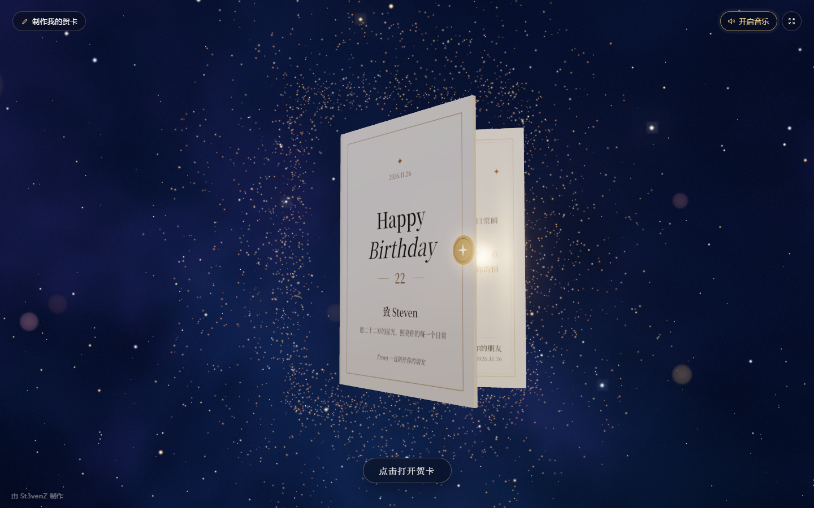
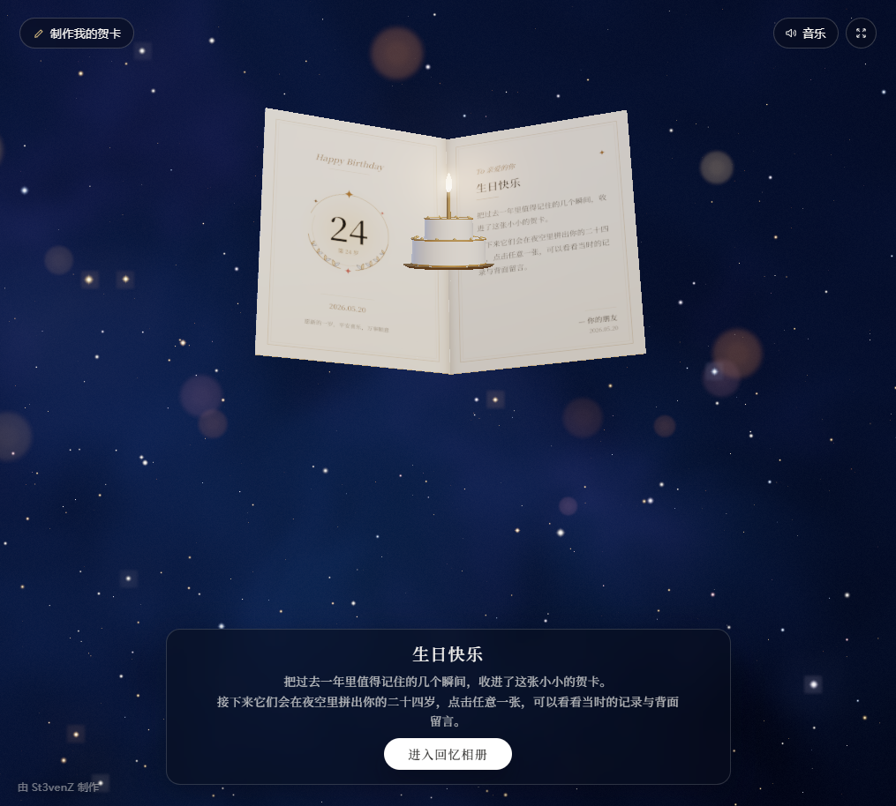
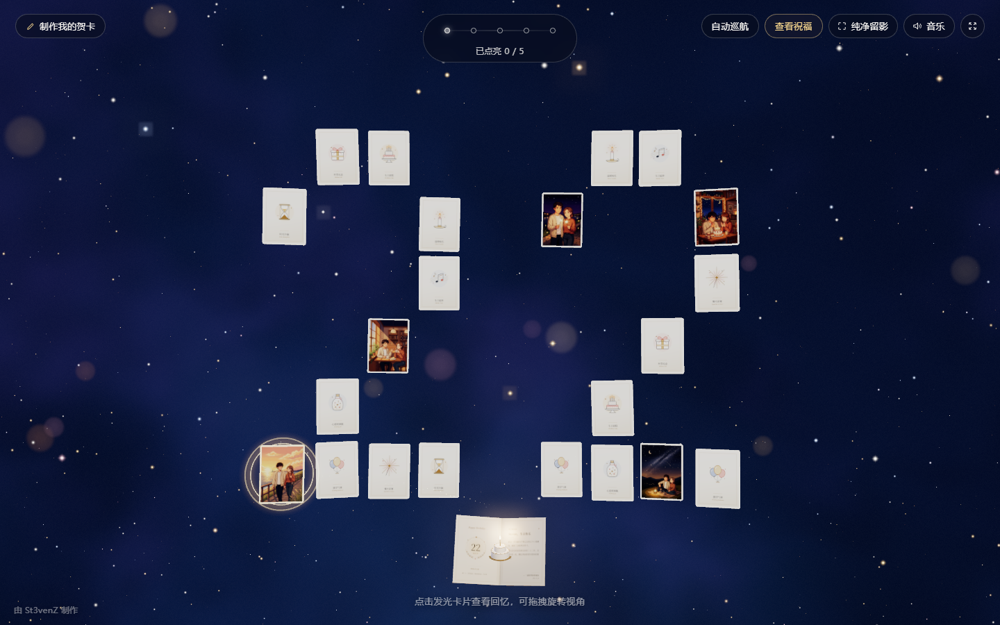
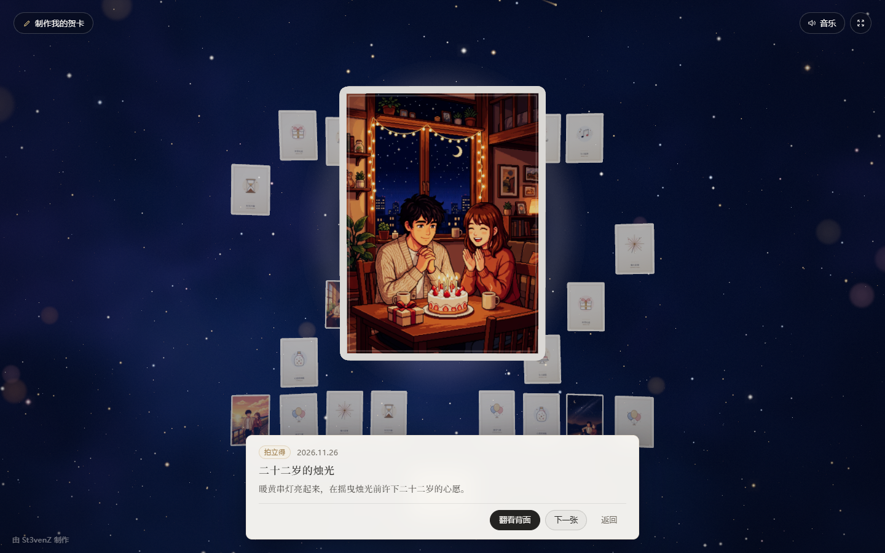
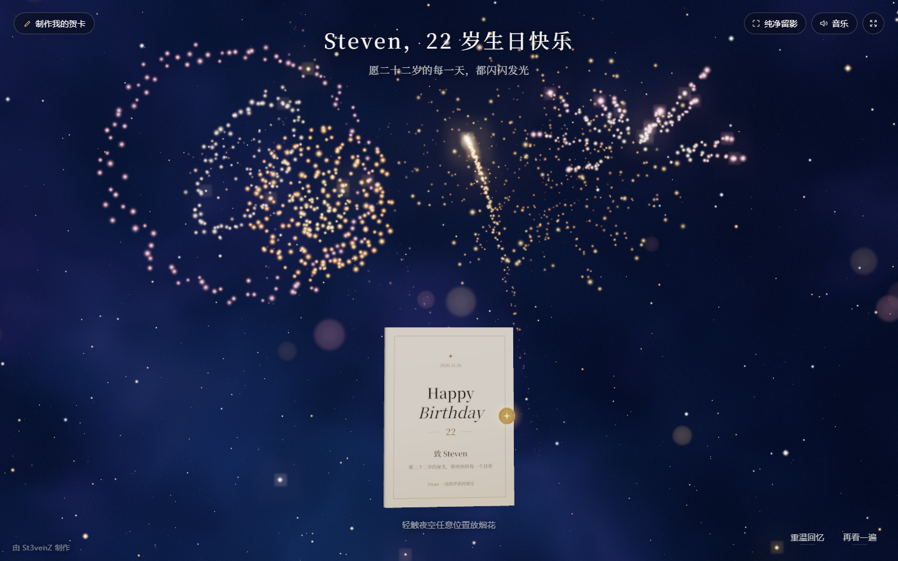
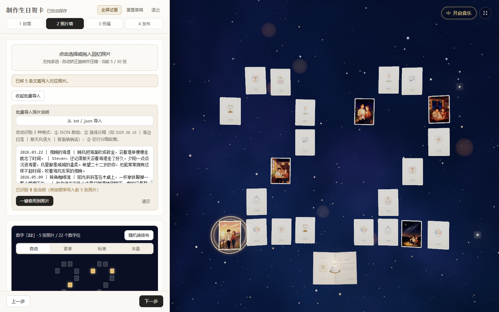
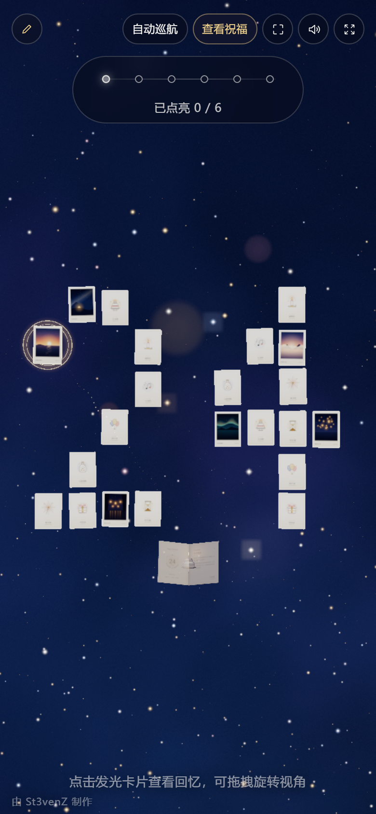
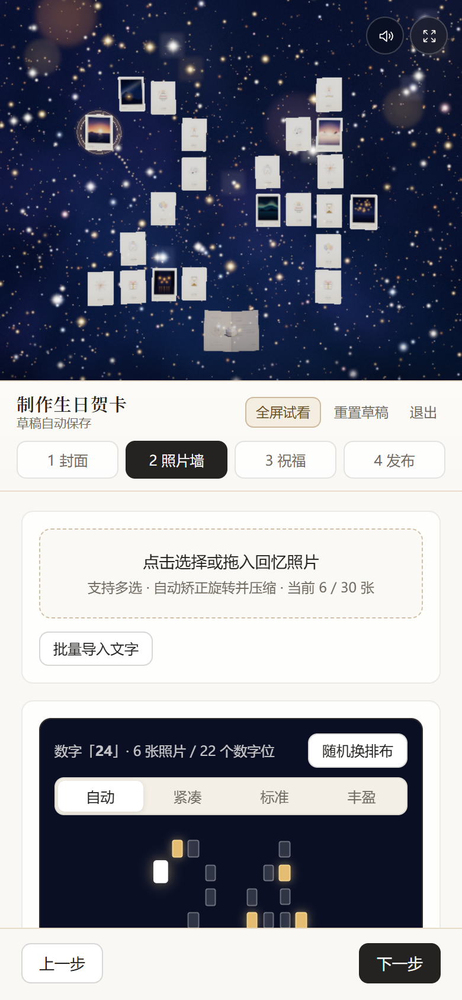

# Starlight 3D Birthday Card

由 **[St3venZ](https://github.com/St3venZ)** 原创设计与开发的纯白棉纸质感 **3D 交互式生日贺卡** 与 **实时分屏创作工坊**。

在深邃的动态星海背景下，一张纯白实体对折贺卡以微开悬念姿态现身；随着指尖点开、翻阅、合拢，依次串联起立体微缩蛋糕、自定义照片拼合的 3D 年龄数字星阵、双面明信片悄悄话、温润白纸长信与满屏粒子烟花。

- **在线体验**：[https://starlight-birthday-card.top](https://starlight-birthday-card.top)
- **创作工坊**：[https://starlight-birthday-card.top/create](https://starlight-birthday-card.top/create)
- **作者主页**：[https://github.com/St3venZ](https://github.com/St3venZ)

---

## 实机演示

### 桌面端五幕 3D 体验

| 第一幕：星尘汇聚与半开纯白贺卡 | 第二幕：展开双页、微缩蛋糕与导语 |
| :---: | :---: |
|  |  |

| 第三幕：3D 年龄数字照片墙 | 第三幕：照片特写与模板文字说明 |
| :---: | :---: |
|  |  |

| 第五幕：合拢纯白贺卡与夜空 3D 烟花 | 实时分屏在线创作工坊（`/create`） |
| :---: | :---: |
|  |  |

### 移动端竖屏体验

| 竖屏 3D 年龄数字照片墙 | 竖屏上下分屏创作工坊 |
| :---: | :---: |
|  |  |

---

## 核心体验与设计细节

- **纯白实体对折美学**
  摒弃厚重花哨的视觉堆砌，以干净挺括的暖白棉纸对折贺卡与深夜星空形成明暗反差。半开缝隙溢出的暖光、展开后左页纪念版画与右页排版寄语、以及尾声中先收起微缩蛋糕再严丝合缝合拢的白卡，构成完整连贯的实体仪式感。
- **任意数量照片 × 3D 年龄数字点阵**
  内置紧凑、标准、丰盈三档 0–9 比例点阵字库（支持 `10–100` 岁），针对数字 `1` 做单独收窄字距校准。无论传入几张或数十张回忆照片，都能通过跨数字配额与排斥加权随机算法自然错落铺排，超出主数字格数的照片则自动落入外围星环陪衬层。
- **照片正面模板说明与 180° 翻面寄语**
  点击点亮任意回忆卡片，照片飞至镜头前时支持四套不同风格的正面排版模板（拍立得寄语 / 极简旁白 / 纪念刻度 / 温柔便签），再次轻点即可翻转 180° 阅读白纸背面的手写感留言。
- **所见即所得实时创作工坊**
  访问 `/create` 从纯净的暖白生日插画底板起步，上传照片即可自动替换数字槽位并生成可跨设备直开的云端短链与纯白扫码海报：支持浏览器端自动方向矫正与压缩、照片列表直接拖拽排序、实时点击点阵地图洗牌或锁位、按单次回车自然分段、批量导入文字、可选 4 位生日口令保护，以及全阶段一键全屏试看。
- **丝滑 60FPS 入场与 Web Audio 声景**
  通过着色器预编译、纹理池复用与空闲分帧水合保障入场零卡顿流畅度；背景音乐与开卡、翻面、点亮、烟花音效全部由纯 Web Audio API 实时合成，亦可自定义伴奏，并针对微信内置浏览器做过首击解锁与状态同步优化。
- **移动竖屏与高分屏清晰度打磨**
  针对主流竖屏视口与微信端做过专项安全区与高分屏渲染适配，结合 WebGL2 MSAA 抗锯齿与实体纸板立体建模，确保 3D 贺卡与年龄数字矩阵在任意缩放倍率下都清晰锐利、毫无闪烁。

---

## 技术栈

- **3D 渲染与后处理**：Three.js / GLSL 自定义着色器 / WebGL2 MSAA / 选择性 HDR Bloom
- **工程与语言**：TypeScript / Vite / Vitest
- **声景与交互**：Web Audio API / Pointer Events / HTML5 & Touch Drag and Drop
- **边缘部署与存储**：Cloudflare Pages Functions & KV

---

Copyright © 2026 **[St3venZ](https://github.com/St3venZ)** | Released under the [MIT License](LICENSE).
